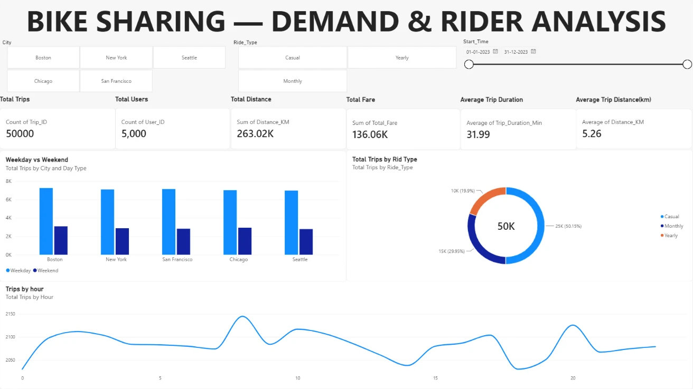
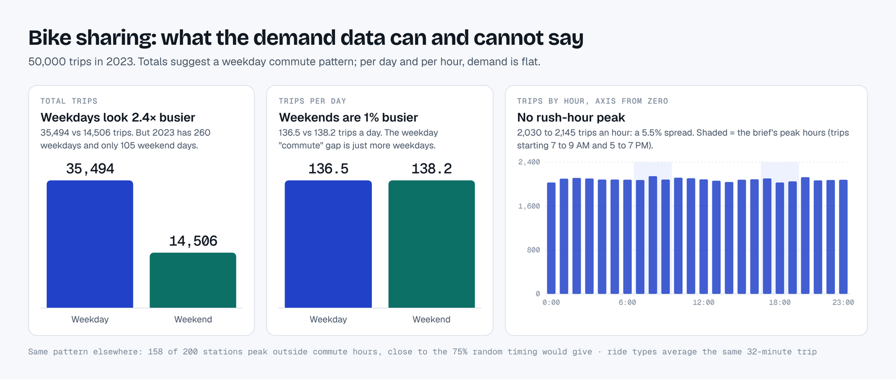
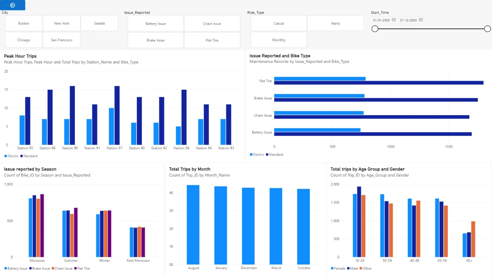
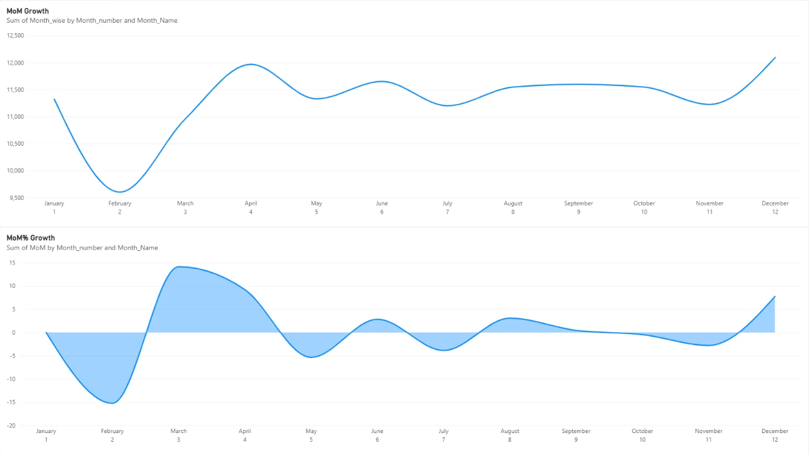

# Bike-Sharing Demand Analysis (SQL + Power BI)

[](https://github.com/parthdhawan921-ops/bike-sharing-demand-analysis/actions/workflows/ci.yml)


A SQL and Power BI analysis of a bike-sharing service: **50,000 trips, 5,000 riders, 200 stations and 1,000 bikes across five US cities in 2023**. Seven related tables are loaded into MySQL, checked, cleaned and analysed in 8 SQL scripts, then reported in a 3-page Power BI dashboard.

**Headline:** weekends look quieter, with 29% of trips, but per day they are slightly busier: 138 trips against 136. The "weekday commute vs weekend leisure" split the case study expects is not in the data. Before reporting it, I tested whether the data could support it and found 72 stations holding more bikes than their capacity, 3,461 trips implying speeds over 40 km/h, and 899 repairs dated before the bike was bought.

**[Interactive case file](https://parthdhawan921-ops.github.io/Parth_Personal/#bike)** · **[📥 Download the Power BI file](powerbi/bike_project_powerbi.pbix)** · Case study from the Coding Ninjas Data Analytics course



---

## 📑 Contents

- [Key findings](#-key-findings)
- [Data checks](#-data-checks-what-the-data-can-and-cannot-support)
- [Dashboard](#-dashboard)
- [SQL analysis](#-sql-analysis)
- [Data model](#-data-model)
- [Power BI fixes to make](#-power-bi-fixes-to-make)
- [How to run](#️-how-to-run)
- [Repository structure](#-repository-structure)
- [Credits](#-credits)

---

## 💡 Key findings

| Area | Finding |
|---|---|
| **Scale** | 50,000 trips, 263,025 km ridden, 31.99 minutes and 5.26 km per average trip |
| **Revenue** | 136,064.69 in fares (no currency in the data): subscriptions 60.3%, pay-per-ride 39.7% |
| **Weekday vs weekend** | 35,494 vs 14,506 trips in total, but **136.5 vs 138.2 trips a day**: no weekday commute effect |
| **Time of day** | Busiest hour 8 AM (2,145 trips), quietest midnight and 6 PM (2,030): only a 5.5% spread |
| **Peak vs off-peak** | 32.24 min / 5.28 km vs 31.90 min / 5.26 km: the same trips at any hour |
| **Ride types** | Casual 50.1%, Monthly 30.0%, Yearly 19.9% of trips; all average about 32 minutes |
| **Station balance** | Station 1 gains 65 more bikes than it loses, Station 148 loses 63; 32 stations are off by 40 or more |
| **Station peaks** | 158 of 200 stations peak outside commute hours, close to the 75% random timing would give |
| **Revenue trend** | February fell 15.2% month on month, but per day only 6.1%: most of the dip is its 28 days |
| **Maintenance** | 9,998 repairs and 240,013 downtime hours; flat tyres lead (2,586). Usage does not predict repairs (r = 0.04) |

---

## 🔍 Data checks: what the data can and cannot support

The case study asks for commute patterns, weather effects and station shortages. These checks in [`sql/01_data_quality.sql`](sql/01_data_quality.sql) test whether the data can answer that.

| Check | Result | What it means |
|---|---|---|
| Duplicates and nulls | 0 duplicate trips, 0 missing values, 0 negative durations; **2 duplicate repair rows removed** | The files are clean on the surface |
| Weather coverage | 8,760 readings, **one city per hour**, not five | Weather cannot be matched to city demand |
| Payments | 3,159 of 5,000 riders have a payment; 1,989 pay-per-ride payments for 50,000 trips | Revenue per trip cannot be measured |
| Station capacity | **72 of 200 stations** report more bikes available than they can hold | Availability figures are unreliable |
| Repair dates | **899 repairs dated before the bike was bought**; 996 of 1,000 bikes' last-service date disagrees with the log | Bike-age analysis is unreliable |
| Trip speed | **3,461 trips imply over 40 km/h** (up to 119.9); distance and duration correlate at 0.001 | Distance and duration were generated independently |
| Rider profile | 63.8% of trips use a ride type different from the rider's subscription; 80% start outside the rider's home city | Segment comparisons blur |

**Conclusion:** the dataset looks generated, with values drawn independently. The SQL and dashboard methods carry over to real data; the behavioural patterns do not, so the findings above are reported with that limit.



---

## 📊 Dashboard

Built in Power BI Desktop on the MySQL tables, with slicers for city, ride type and date.

| Page | What it shows |
|---|---|
| **1. Overview** | KPI cards, weekday vs weekend by city, trips by ride type, trips by hour |
| **2. Operations** | Peak-hour trips by station, issues by bike type and season, trips by month, trips by age group and gender |
| **3. Revenue growth** | Monthly revenue and month-on-month growth % |

| Operations | Revenue growth |
|---|---|
|  |  |

DAX measures and calculated columns: [`powerbi/measures.dax`](powerbi/measures.dax).

---

## 🧮 SQL analysis

Each script maps to a stage of the case study and runs in order with [`run_all.sh`](run_all.sh).

| Script | Stage | What it answers | Techniques |
|---|---|---|---|
| [`00_create_and_load.sql`](sql/00_create_and_load.sql) | Setup | Creates `bike_project` and loads the 7 CSVs | DDL, `LOAD DATA LOCAL INFILE` |
| [`01_data_quality.sql`](sql/01_data_quality.sql) | 1 and 2 | Volumes, nulls, duplicates, durations, station names, plus 7 validation checks | Window functions, de-duplication with `ROW_NUMBER`, Pearson r in SQL |
| [`02_exploration.sql`](sql/02_exploration.sql) | EDA | Dimensions, date ranges and measures for every table | Aggregation, `CASE` buckets |
| [`03_demand_peak_usage.sql`](sql/03_demand_peak_usage.sql) | 3 | Hourly demand, weekday vs weekend per day, station net flow, peak vs off-peak, unusual station peaks | CTEs, `RANK`, window averages |
| [`04_user_segments.sql`](sql/04_user_segments.sql) | 4 | Ride-type behaviour, top riders, time-of-day preference, fare ranking | Grouping, ranking |
| [`05_predictive_maintenance.sql`](sql/05_predictive_maintenance.sql) | 5 | Issues by season and station, recent-repair share per station, usage vs repairs | Multi-step CTEs, correlation |
| [`06_kpi_measure_table.sql`](sql/06_kpi_measure_table.sql) | Report | One KPI table that feeds Power BI | `UNION ALL` |
| [`07_monthly_revenue_mom.sql`](sql/07_monthly_revenue_mom.sql) | Report | Monthly revenue, MoM growth and growth per day | `LAG` |

Peak hours follow the case study: trips starting 7 to 9 AM and 5 to 7 PM. Seasons use the US meteorological calendar.

---

## 🗂️ Data model

```text
users_data ──< trips_data >── bikes_data ──< maintenance_data
     │            │   │
     │            │   └── stations_data   (Start_Station_ID active, End_Station_ID inactive)
     └──< revenue_data
weather_data       (stand-alone: one city per hour, so no reliable join)
```

All relationships are many-to-one with single-direction filters. Arrivals use `USERELATIONSHIP` on the inactive end-station relationship. Full column list: [`data/metadata.md`](data/metadata.md).

---

## 🔧 Power BI fixes to make

The `.pbix` is kept as built. These changes would make it stronger (they need Power BI Desktop):

1. **Seasons:** the `Season` column uses Indian seasons (Monsoon, Post-Monsoon) for US cities. Switch to Winter (Dec to Feb), Spring, Summer and Autumn.
2. **Weekday vs weekend:** show trips **per day**, not totals, so 2.5× more weekdays do not read as commuting.
3. **Trips by hour:** start the y-axis at 0; it currently starts near 2,030, so a 5% wiggle looks like rush-hour peaks.
4. **Trips by month:** the visual shows only the top 5 months; show all 12 or rename it.
5. **Revenue growth source:** page 3 reads a CSV from a local `D:\` path; point it at [`07_monthly_revenue_mom.sql`](sql/07_monthly_revenue_mom.sql) instead.
6. **Auto date/time:** turn it off (8 hidden date tables) and add one shared date table.
7. **Labels:** "Total Trips by Rid Type" → "Ride Type"; replace "Count of Trip_ID" style card labels with the measure names.

---

## ▶️ How to run

1. Install **MySQL 8.0** and enable `local_infile`.
2. From the repository root: `./run_all.sh -u root -p`. It builds `bike_project` from `data/` and runs every script in order.
3. Open [`powerbi/bike_project_powerbi.pbix`](powerbi/bike_project_powerbi.pbix) in Power BI Desktop and point the data source at your MySQL server.

Every push runs the full build on MySQL 8.0 in GitHub Actions and checks the headline figures in [`tests/check_results.sql`](tests/check_results.sql).

---

## 📂 Repository structure

```text
.
├── .github/workflows/ci.yml   # Builds the database and runs every query on each push
├── data/                      # 7 source CSVs + metadata.md (data dictionary)
├── images/                    # Dashboard pages and the demand reality-check chart
├── powerbi/
│   ├── bike_project_powerbi.pbix
│   └── measures.dax           # DAX measures and calculated columns
├── sql/                       # 00 to 07, run in order
├── tests/check_results.sql    # Headline figures the CI verifies
├── run_all.sh                 # One-command build
└── README.md
```

---

## 🙏 Credits

Dataset and business questions: the **"Bike-Sharing Services Analysis"** SQL case study from the [Coding Ninjas](https://www.codingninjas.com/) Data Analytics course. The SQL, validation checks and Power BI dashboard are my own work on that brief.

---

## 👨‍💻 Author

**Parth Dhawan**: Data Analyst · SQL · Python · Excel · Power BI

[Portfolio](https://parthdhawan921-ops.github.io/Parth_Personal/) · [GitHub](https://github.com/parthdhawan921-ops) · [LinkedIn](https://www.linkedin.com/in/parth-dhawan-31516127a/)
